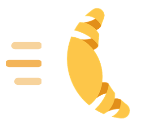
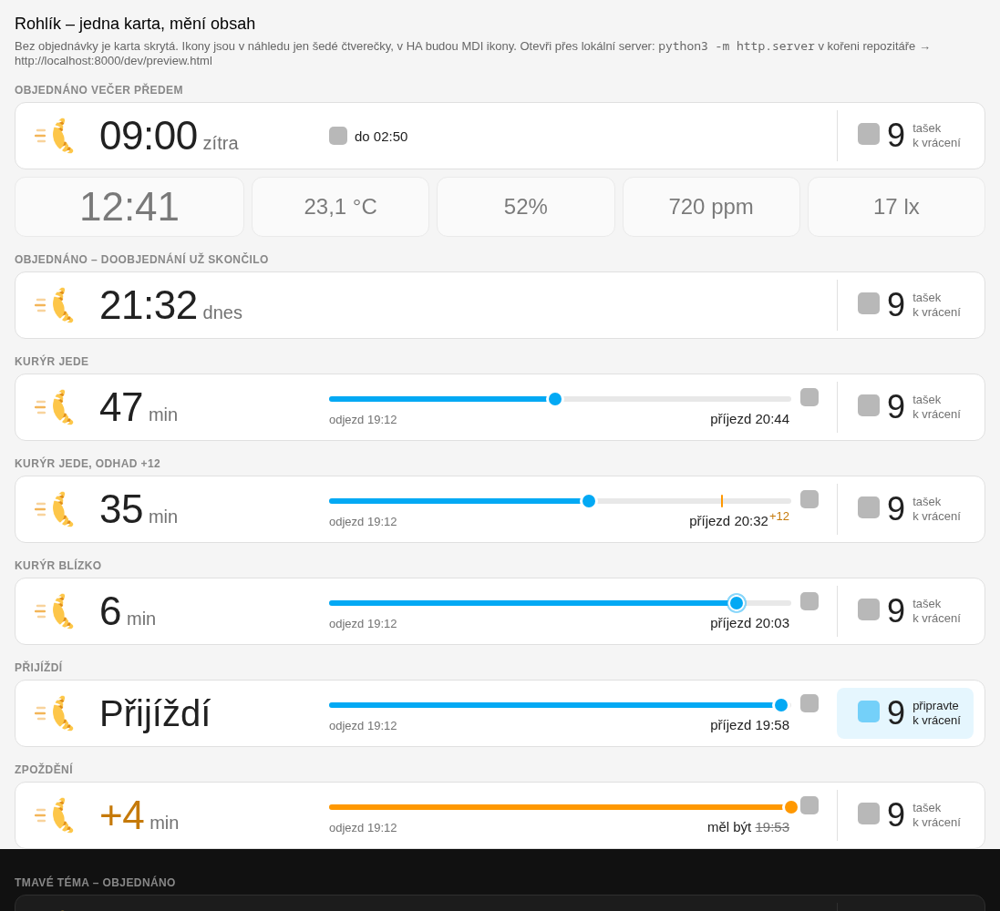

# Rohlík.cz Delivery Banner

[](https://github.com/hacs/integration)
[](https://github.com/hruskin/rohlik-courier-card/releases)

A slim full-width Home Assistant dashboard banner for [Rohlík.cz](https://www.rohlik.cz) deliveries. It changes with your order and stays out of the way otherwise:

- **Ordered** — the delivery time (`09:00 zítra`) and, with a cart icon, until when items can still be added (`do 02:50`).
- **Courier on the way** — the countdown to the live ETA and the trip progress from the courier's departure to the live ETA (the marker slides back and a small *+N* appears when the ETA moves later), a pulsing marker in the final minutes, *Přijíždí* at arrival and *+N min* in orange when late. The courier's name and phone stay in the sensor's details.
- **Always** — the reusable bags to hand back to the courier.
- **No order** — hidden (the dashboard editor shows a preview).
- **Tap** — the list of items in the order (name and amount), dropping down right under the banner.

The banner is about 72 px tall in every state and stays on one row down to phone widths, follows the dashboard theme (light and dark) and its texts are Czech.



## Requirements

- The Rohlík.cz integration with courier tracking — [hruskin/HA-Rohlik-dynamic](https://github.com/hruskin/HA-Rohlik-dynamic) ≥ 1.0.3. It provides the *Courier on the way*, *Minutes to delivery* and *Add items until* entities and the order's items; with the upstream integration only the delivery time of the *ordered* state works.

## Installation

1. HACS → ⋮ → **Custom repositories** → `https://github.com/hruskin/rohlik-courier-card`, type **Dashboard**.
2. Download **Rohlík.cz Delivery Banner**. HACS adds the Lovelace resource.
3. Reload the browser (no Home Assistant restart needed — also for updates).

## Usage

Put it at the top of a sections dashboard, full width:

```yaml
type: grid
column_span: 4
cards:
  - type: custom:rohlik-courier-card
```

Everything can be set in the visual editor. The card finds the integration's entities on its own; with more than one Rohlík.cz account, pick them there (or with `<name>_entity` in YAML):

| Option | Meaning |
|---|---|
| `show_logo` | Rohlík.cz logo on the left (default `true`; loaded from the Home Assistant brands repository, falls back to a state icon offline) |
| `number_weight` | `regular` (default) or `bold` — weight of the big countdown/time and bags numbers |
| `courier_entity` | binary sensor *Courier on the way* |
| `eta_entity` | sensor *Delivery time* |
| `minutes_entity` | sensor *Minutes to delivery* |
| `bags_entity` | sensor *Reusable bags* |
| `ordered_entity` | binary sensor *Next order* |
| `info_entity` | sensor *Delivery info* |
| `since_entity` / `till_entity` | sensors *Delivery slot start / end* |
| `deadline_entity` | sensor *Add items until* |

Tapping the banner opens the list of items in the order; without items (older integration) it opens the order or the courier details.

## Development

The card is a single dependency-free file, [`rohlik-courier-card.js`](rohlik-courier-card.js).

- **Without Home Assistant:** `python3 -m http.server` in the repository root and open <http://localhost:8000/dev/preview.html> — every state with mock data, light and dark.
- **In Home Assistant without releases:** copy the file to `/config/www/rohlik-courier-card.js`, add the resource `/local/rohlik-courier-card.js?v=1` (Settings → Dashboards → ⋮ → Resources, type *JavaScript module*) instead of the HACS one, and bump `?v=` (or hard-reload) after every change.
- **Release:** bump `VERSION` in the card, then publish a GitHub release `vX.Y.Z`; the workflow checks the version and attaches the file for HACS.

## License

MIT. The croissant is the Rohlík.cz logo (trademark of Rohlik Group, served from the Home Assistant brands repository); this is an independent community project, not affiliated with Rohlík.cz.
